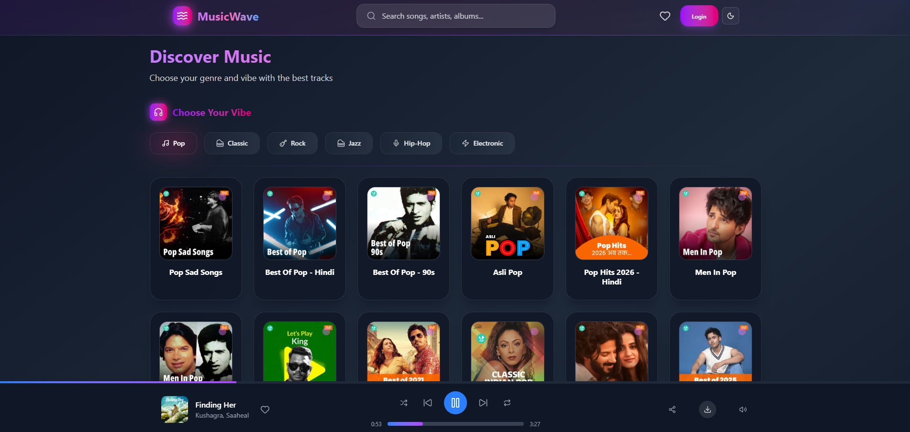

# MusicWave 🎵

A modern, responsive music streaming web application built with [Next.js](https://nextjs.org), designed for seamless audio playback, playlist discovery, and curated listening experiences.

🔗 **Live Demo:** https://musicwavee.vercel.app/



---

## ✨ Features

- **Persistent Audio Player:** Play, pause, skip, scrub progress, adjust volume, and toggle shuffle/repeat across page navigations.
- **Browse & Discover:** Explore trending tracks, curated playlists, albums, and top artists.
- **Search & Filtering:** Instant search across songs, albums, and artists.
- **Playlist Management:** Create, edit, and organize custom playlists and liked songs.
- **Responsive UI:** Fluid layout tailored for desktop players and mobile listening on the go.

---

## 🛠️ Tech Stack

- **Framework:** [Next.js](https://nextjs.org) (App Router)
- **Language:** [TypeScript](https://www.typescriptlang.org)
- **Styling:** [Tailwind CSS](https://tailwindcss.com)
- **Typography:** [Geist](https://vercel.com/font) via `next/font`
- **State / Audio:** *(e.g., Zustand / React Context / HTML5 Audio API / Howler.js)*
- **Backend / Storage:** *(e.g., Supabase / Firebase / Cloudinary / Spotify API)*
- **Deployment:** [Vercel](https://vercel.com)

---

## 🚀 Getting Started

Follow these steps to run **MusicWave** locally on your machine:

### Prerequisites

- [Node.js](https://nodejs.org) (v18.17 or higher)
- npm, yarn, pnpm, or bun

### Installation

1. **Clone the repository:**
   ```bash
   git clone [https://github.com/afkshreshtha/musicwave.git](https://github.com/afkshreshtha/musicwave.git)
   cd musicwave
